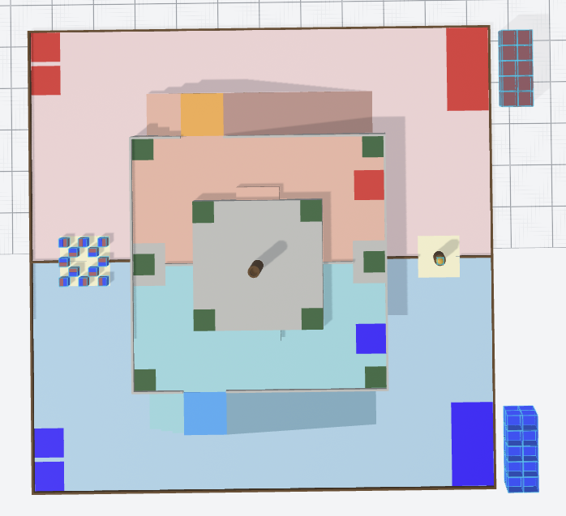
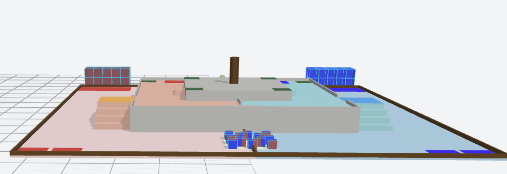

# RC 2027 Field — MuJoCo Models

**ABU Robocon 2027「The Pursuit of Mustika Nusantara」场地的 MuJoCo 模型**（静态版 + 比赛用品可动版）。
文件名与路径全部 ASCII，解压即用；已用 **MuJoCo 3.14.0** 实测加载、静置与推动。

> **English** — MuJoCo models of the ABU Robocon 2027 game field: a static field
> (`field.xml`) and a simulation-ready variant with movable game objects
> (`field_with_objects.xml`: 12 sky blocks + Mustika + 40 earth blocks as free-joint bodies).
> All paths are ASCII, units are metres, z is up, origin is the field centre.
> Verified with MuJoCo 3.14.0. MIT licensed (see `LICENSE`).
> The field design and the game rules belong to ABU Robocon / the organisers — this is an
> **unofficial** simulation asset, see [Attribution](#attribution).

---

## 0. 预览 / Preview





> 两张图为模型的截图：**`俯视图.png`** 正上方俯视（**北在上、东在右**），**`正视图.png`** 自南向北的立面
> （**右 = 东(+x)、上 = 高度 z**）。图中可见：场外北侧红/蓝各 20 个地块堆（紧邻各自储存区）、
> 南侧中央第一公共区的 12 个天空块棋盘位（中心格空置）、北侧中央的五色石基座与凹槽里的五色石、
> L1 台体（0.6 m）与 L2 台体（0.9 m）、中央基座（顶 1.725 m）、以及 L1 东西两侧的过渡带（台阶在南、坡道在北）。
>
> 用 `mujoco.MjModel.from_xml_path("rc2027_field/field_with_objects.xml")` 打开同一模型即可得到可交互的实时画面。

---

## 1. 文件结构 / Contents

```
rc2027_field/
├─ field.xml                  静态场地：39 mesh / 15 材质 / 10 建塔点 site / 1 灯光 + 3 相机
├─ field_with_objects.xml     ★ 仿真主用：静态场地 + 53 个 freejoint 可动件 + primitive 碰撞层
├─ meshes/                    65 个 OBJ（全 ASCII 名，按角色命名）
│   ├─ field/  (39 个)          场地件，世界坐标（米、原点=场心、z 向上）
│   │     ground_red/blue · l1_platform · l1_floor_red/blue · l2_platform
│   │     fence_perimeter · l1_fence_perimeter · mustika_pillar · central_pillar
│   │     storage_red/blue · start_red/blue · shared_area_south/north
│   │     l1_retry_red/blue · transition_{red,blue}_{stairs,transfer,ramp}
│   │     l2_stairs_red/blue · build_spot_01..10 · mustika_in_place
│   └─ objects/ (26 个)         比赛用品件，网格已居中（供 freejoint 刚体用）
│         sky_block_01..12_red/blue.obj（12 块 × 红/蓝半盒）
│         mustika.obj（Ø0.20 m 球）· earth_block.obj（0.35 m 立方体）
├─ 俯视图.png                 预览：正上方俯视（北在上、东在右）
├─ 正视图.png                 预览：自南向北立面（右=东、上=高度）
├─ example_load.py            最小示例：加载、打印统计、静置 1 s、列出可动件位姿
├─ README.md                  本文件
├─ LICENSE                    MIT
└─ .gitattributes             统一 LF
```

两个版本**几何完全一致**，区别只在"能不能动"：

|  | `field.xml` | `field_with_objects.xml` |
|---|---|---|
| 用途 | 静态参考 / 视觉 / 区域核对 | 强化学习与仿真（含抓取/推挤） |
| geom | 39（全 mesh） | 190（101 mesh 视觉 + 89 primitive 碰撞，碰撞体不可见） |
| body | 0 | **53**（12 天空块 + 五色石 + 40 塔基/中段） |
| 自由度 | — | nq=371, nv=318 |
| 天空块/五色石/地块 | 作为场地网格画死在原位 | 可动刚体（freejoint） |

---

## 2. 快速开始 / Quick start

```bash
pip install mujoco          # 已验证 3.14.0
python example_load.py      # 自检两版模型 + 静置 1 s + 打印 53 个可动件位姿
```

`example_load.py` 是给第一次拿到本包的人用的**最简上手 + 自检脚本**（约 90 行、只依赖 mujoco/numpy）：
它会把两个 XML 都加载一遍并比对文件里声明的 geom/mesh/body/site 计数（`✓`/`✗`），
再把 `field_with_objects.xml` 静置 1 s、列出每个可动件的坐标与位移（毫米级 = 只是落到接触面上），
最后打印"给可动件施加速度"的两行示例代码。它**不改任何文件**，只读模型、跑数据，可当烟雾测试用。

```python
import mujoco

# 静态场地
m = mujoco.MjModel.from_xml_path("rc2027_field/field.xml")
print(m.ngeom, m.nmesh, m.nsite)          # 39 39 10

# 可动比赛用品版（仿真用这个）
m = mujoco.MjModel.from_xml_path("rc2027_field/field_with_objects.xml")
d = mujoco.MjData(m)
mujoco.mj_forward(m, d)
print(m.ngeom, m.nmesh, m.nbody - 1, m.nq)   # 190 65 53 371

# 自己加机器人：往 worldbody 里 append 你的 body 即可，场地是纯静态 geom
# 可动件按名字索引：
import numpy as np
bid = mujoco.mj_name2id(m, mujoco.mjtObj.mjOBJ_BODY, "mustika")
print(d.xpos[bid])                        # 观测里可以直接用 xpos / qvel
```

**Windows 注意**：MuJoCo 的 C++ 层无法打开含非 ASCII 的路径（如 `F:\桌面\…`）。
把 `rc2027_field/` 放到纯英文路径（`C:\rc2027\`）再用 `from_xml_path()`；
或把文件读成 bytes 走 `from_xml_string(xml, {file_attr: bytes})`（键名 = XML 里 `file` 属性的值，
**不带** `meshdir` 前缀）。Linux 无此限制。

---

## 3. 坐标系与场地几何 / Frame & geometry

* 单位 **米**，**z 向上**，**原点 = 场地中心**。场地 11.1 m × 11.1 m（= 11 000 mm + 围栏）。
* 若你的代码用"西南角原点"，换算：`corner = centred + 5.5`（两轴都加）。
* 主要尺寸（与规则一致，均已核对）：

| 构件 | 尺寸 | 备注 |
|---|---|---|
| 地面区 | 11.1 × 11.1 m，顶面 z=0.025 | 红=西半场、蓝=东半场（关于 x=0 镜像） |
| L1 | 6 × 6 m，高 0.6（顶面 z=0.625） | 台面红/蓝各半 |
| L2 | 3 × 3 m，高 0.9（顶面 z=0.925） | 公共区 |
| 过渡带 ×2 | 台阶 3 级（每级 300×1000×150）+ 传递区平台 1000×1000 + 坡道 3500×1000（9.74°） | 红 x∈[−4,−3]、蓝 x∈[3,4]，y∈[−2.7,+2.7]；**台阶在南、坡道在北** |
| 五色石基座 | Ø270，高 500，顶部凹槽 Ø180×100 | 位于 (0, +4.25) |
| 中央基座 | Ø270，高 800（顶面 z=1.725） | 位于场心 |
| 建塔处 | 500 × 500 ×10 | 同时导出为 10 个 `<site>`（`site_建造点-N-N`），与区域常量逐点相等 |
| 储存区 ×2 | 1000 × 2000 | 红 x∈[−5.5,−3.5]、蓝 x∈[3.5,5.5]，y∈[4.5,5.5] |

* **材质**共 15 个，命名即颜色（`rgb_RRR_GGG_BBB`），取值来自规则附录 1 的材质/颜色表，
  可直接用于颜色识别任务的真值。**两处按本项目的决定做了调整**（非规则表原值）：
  储存区用队伍色（`rgb_223_034_034` / `rgb_050_000_255`，规则表里它与"地面区"同值）、
  塔基/中段用队伍色（规则表未给该件颜色）。若你要严格贴附录 1，改这两个 geom 的 `material` 即可。

---

## 4. 可动比赛用品（`field_with_objects.xml`）/ Movable objects

质量与尺寸取自规则原文；初始位姿取自官方装配 CAD（仅块底抬高 1.1 mm 以免初始穿透）。

| 对象 | 数量 | 质量 | 碰撞体 | 视觉 | 初始位置 |
|---|---|---|---|---|---|
| 天空块（塔顶） | 12 | **0.22 kg**（规则 220 g ±20%） | 0.2³ box | 红半/蓝半两个 mesh | 第一公共区 5×5 棋盘、**正中格空置**，间距 0.2333 m，块心 z=0.125 |
| 五色石（Mustika） | 1 | **0.27 kg**（规则 260–280 g） | r=0.10 球 | `objects/mustika.obj`（Ø0.20） | (0, +4.25, z≈0.569)，卡在基座凹槽里 |
| 塔基/中段（地块） | **40**（红 20 + 蓝 20） | **0.60 kg**（ABU 600 g ±20%） | 0.35³ box | `objects/earth_block.obj` | 各自储存区外侧场外，2 层 × 2 排 × 5 列，间距 0.36 m，红堆 x≈−4.5、蓝堆 x≈+4.5，y∈[5.93, 6.46] |

命名（body 名 = 观测索引，`<name>_joint` 是 freejoint）：
`skyblock_01…12`、`mustika`、`earthblock_red_01…20`、`earthblock_blue_01…20`。

### 为什么场地网格在可动版里"不碰"了

MuJoCo 用**凸包**做 mesh 碰撞，而例如"场地外围围栏"这种网格的凸包会**填满整个场地**
（实测：40 个地块全被托在一块假地板上，z=0.125）。因此 `field_with_objects.xml` 采用标准两层结构：

* **视觉层** = 原 39 个 mesh geom，`contype=0 conaffinity=0`（带原材质，供相机渲染）；
* **碰撞层** = primitive（全部 `rgba="1 1 1 0"` 不可见）：
  `col_ground`（±10 m，兼顾场外堆放区）、`col_l1`、`col_l2`、
  场地围栏 4 块、L1 围栏 4 块、`col_pillar_centre`、
  五色石基座圆柱 + **12 个小 box 拼成的凹槽环**（五色石因此能卡在槽里）、
  两条过渡带各「平台 + 3 级台阶 + 9.74° 斜板」、两块 `col_l2stair_*`。

好处：台阶/坡道是**精确接触**，且 CPU 上比 mesh 碰撞快得多。

---

## 5. 已验证 / Verified (MuJoCo 3.14.0, 2026-09)

| 测试 | 结果 |
|---|---|
| 加载 `field.xml` | 39 geom / 39 mesh / 10 site ✓ |
| 加载 `field_with_objects.xml` | 190 geom / 65 mesh / 53 body / nq=371 / nv=318 ✓ |
| 与场地源网格一致性 | 39 件 `part_*.obj` = 8 220 顶点 / 6 538 面；两版几何 AABB 偏差 0.00e+00 |
| 静置 1.5 s（750 步 @2 ms） | **53/53 稳定**：12 块天空块落到地面（下沉 1.2 mm = 预留间隙）、五色石稳在凹槽、地块堆不散；水平漂移 0 |
| 推动 五色石 2 m/s | 弹出凹槽并滚过全场 **≈132 cm** |
| 推动 天空块 2 m/s | 滑行 **≈17 cm** 后停（与 v²/2μg 一致） |
| 推动 地块 2 m/s | 滑行 **≈81 cm** |

复现：`python example_load.py`（含静置测试与位姿打印）。

---

## 6. 已知限制 / Known limitations

1. **L2 阶梯的碰撞层只有一级**（150 mm）：规则上 L2 高出 L1 300 mm，应两级；CAD 网格也只给了一级，需自行补第二级。
2. **坡道碰撞体是一块倾斜板**（9.74°），没有做"板下空腔"，从坡道下方穿过会被挡住。
3. **质量是规则基准值**（0.22 / 0.27 / 0.60 kg），未做域随机化；做 DR 时按规则公差采样
   （±20% / 260–280 g / ±20%）并保持 `size_tol ≤ 5%`。
4. **`field.xml` 的 mesh 会按凸包参与碰撞** —— 静态参考没问题，仿真请用 `field_with_objects.xml`。
5. 场地几何为**非官方复刻**：数值按官方规则与官方装配 CAD 派生，但赛事方可能修订规则/场地。
6. geom/site 名称是**中文**（UTF-8 安全，MuJoCo 支持）。非中文环境可参考下表对应：

| 中文名 | English | 中文名 | English |
|---|---|---|---|
| 红1区 / 蓝1区 | ground area red / blue | 二层基座 | L1 platform |
| 1区栅栏 | perimeter fence | 3区 | L2 platform |
| 1区启动区-红/蓝 | start zone | 2区栅栏 | L1 perimeter barrier |
| 1区储存区-红/蓝 | storage area | 2区重试区-红/蓝 | L1 retry zone |
| 1区-地面共享区 | ground shared area (first public area, 12 sky blocks) | 建造点-1…10 | building spot |
| 1区-地面附加共享区 | second public area (Mustika) | 灵石 | Mustika |
| 台阶-{红,蓝}-{阶梯,传递区,坡道} | transition: stairs / transfer area / ramp | 天空块-{红,蓝} | sky blocks (red/blue faces) |

---

## 7. 来源与生成方式 / Provenance

* 尺寸/质量/颜色依据：`Robocon_2027_Rulebook_v1-1.pdf`（ABU 原版）与
  `第二十六届全国大学生机器人大赛女娲补天竞技赛规则V1.pdf`（国内版），附录 1 材质规格与颜色表。
* 几何来自**官方装配 3DXML**（SolidWorks 导出）解析后的 39 个 mesh；本包中的
  `meshes/field/*.obj` 与那次导出**逐字节一致**（8 220 顶点 / 6 538 面）。
* 过渡带两条带的位置/朝向在本项目中按比赛路线调整：x∈[−4,−3] / [3,4]（贴 L1 外侧地面环道）、
  y∈[−2.7,+2.7]，**台阶在南、坡道在北**；用 geom 的 `pos`+`quat`（绕场心竖轴 180°）表达，**顶点未改**。
* 12 个天空块与五色石的可动化：从原组网格按连通域拆出 24 个半盒 + 球形网格；
  地块（0.35³）按规则新建几何。

## Attribution

* 比赛、规则与场地设计 © **ABU Robocon / 主办与承办单位**；本包是**非官方**的仿真资产，
  命名与尺寸只为仿真复刻，不代表主办方。
* 请不要把本包当作赛场建造图纸使用；实际场地以赛事方发布的图纸/规则为准。

## License

代码与模型文件以 **MIT** 发布，见 [`LICENSE`](LICENSE)。使用/再分发时请保留本节的来源与归属说明；
若你把本包并入自己的仓库，建议保留 `README.md` 与 `LICENSE`（或至少注明出处）。

## Changelog

* **v1.0**（2026-09）— 首次发布：`field.xml`（静态）与 `field_with_objects.xml`（53 个可动件 + 碰撞层）；
  实测数据见 §5；已知限制见 §6。
